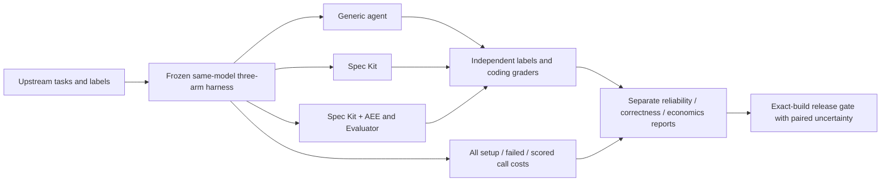

# Spec Kit + AEE: established benchmark evidence

This repository compares a generic agent, Spec Kit and Spec Kit+AEE on established upstream tasks. It owns the thin treatment/provenance/accounting adapter, not a replacement hallucination dataset or coding grader. No 100% coverage target.

| Question | Evidence status | Interpretation |
| --- | --- | --- |
| Can the model detect supplied hallucinations? | [HaluEval 100/120; RAGTruth 97/120](reports/hallucinations/external-01-20261019/README.md) | Complete model-only subset results; 83.3%/80.8%, 213457 native tokens, 0 usage unknowns |
| Does Spec Kit or AEE materially help? | Matched 03 running; complete paired results pending | No treatment-benefit claim yet |
| When does workflow overhead pay back? | FeatureBench Fast v1.1 / SWE-EVO resources prepared, not executed | No observed short/long-horizon savings yet |
| Can builds gate future releases? | Content-bound requests + strict comparison/verifier; no accepted release baseline yet | Release remains blocked without full audited exact-build approval |

[Harness I/O diagram and results guide](docs/benchmark-harness.md) · [Release gate diagram and policy](docs/benchmark-release-gates.md) · [Long-horizon design](docs/long-horizon-economics-plan.md) · [Resume](START_HERE.md)

[Optimizer extension evaluation plan](docs/optimizer-extension-evaluation-plan.md): test individual benefits, confirm finalists on held-out work, then decide whether to reuse extensions or compose a bundle. This is deferred work, not a change to the active benchmarks or evidence of savings.

The active matched run stays frozen while documentation and release infrastructure are changed in a separate checkout. Retired custom task suites, synthetic factbooks and failed runs remain historical evidence; they are not rerun as active release benchmarks. Only thin adapter-integrity checks remain maintained by this repository. Tokens include all setup/failed/scored calls; API 0 excludes hardware, energy and labor. Detector labels, coding grades and AEE gate eligibility stay separate.



<details>
<summary>Historical results and earlier experiment documentation (read only)</summary>

# Spec Kit + AEE benchmark

**Matched detector attempt 01 stopped at its first output-limit failure:** 72/720 final judgments graded; 1 attempted/ungraded; 647 unattempted. All 185 calls and 712,919 known native tokens are retained, with 0 usage unknowns. The model identity was correct; an unbounded rationale exhausted the 1,024-token response cap. [Stopped report and complete scheduled inventory](reports/hallucinations/matched-01-stopped-20261019/README.md). Prospective v2 bounds native JSON strings equally across all arms while preserving token caps, tasks, labels and graders. A fresh attempt is pending validation; no completed matched efficacy or economic benefit is asserted.

**Separate external hallucination results completed:** HaluEval 100/120 correct (83.3%; 17 missed hallucinations, 3 false alarms); RAGTruth 97/120 correct (80.8%; 11 missed hallucinations, 12 false alarms). All 240 responses were independently graded, with 0 abstentions/invalid responses/usage unknowns and 213,457 known native tokens. [Full results, confusion counts, intervals and receipts](reports/hallucinations/external-01-20261019/README.md). These are public-dataset response-detection subsets, separate from coding and the synthetic factbook test. **No AEE or Spec Kit treatment effect was measured.**

**Latest coding study 08 stopped immediately:** 13 calls/79,682 known native tokens, 0 usage unknowns. A model argument array included shell separators as literal arguments to `test`, which exited 2. No retry or next trajectory ran. The coding comparison remains incomplete; the separate detection results do not repair or complete that comparison.

**Historical study 04 is stopped by user direction.** The Cachetools loop exposed failed tool calls being treated as successful actions until the repeat limit, followed by continuation to another trajectory. The prospective runner now halts on the first protocol/tool/verification failure. [Diagnosis, retained costs and fail-fast amendment](reports/investigation/fail-fast-cachetools-20261019/README.md). Main benchmark results remain incomplete.

**Pipeline 12 stopped before scoring:** image/grader controls passed, then a direct-client connection timed out during context validation. A persistent-client mitigation and fresh zero-generation context checks pass; no shared service/model changed. [Evidence, transport scope and retained setup accounting](reports/investigation/fail-fast-cachetools-20261019/context-connection-followup.md).

**Latest study 07 stopped on its first malformed grep action:** 15 native calls, original output retained. The prospective v6 tool interface removes shell-command strings and requires literal argument arrays for every arm. Fresh native grammar/timing validation is required before another scored run. [Current protocol](benchmarks/current_local/PROTOCOL-v2.md#current-v6-action-protocol-literal-argv-only). No completed comparison is claimed.

**Corrected real-model hallucination diagnostic completed:** 12/12 frozen-label agreement (supported 4, contradicted 4, unknown 4), 0 invalid responses, 12 calls/1,974 known native tokens/0 usage unknowns. [Receipts, correction history and limits](reports/local/labelled-factbooks-11-20261019/README.md). This is a small synthetic factual-judgment test, not AEE efficacy or workflow hallucination prevalence.

**Study 03 stopped on infrastructure (2026-10-19):** 98 calls/1,908,355 known native tokens, 2 attempted/34 unattempted checkpoints. TinyDB partial source passes 225 public+228 hidden tests, but there is no final delivery or valid paired comparison. [Captured error, independent grades and retained results](reports/local/current-study-03-router-stop/README.md).

**Real-model labelled diagnostic completed:** 12 calls, 10/12 original-label agreement, with two challenged fixture labels and explicit limits. [Receipts and findings](reports/local/labelled-factbooks-10-20261019/README.md). The fresh software benchmark stopped on a router connection error; no completed paired result is claimed.

Current mission: finish benchmarks and labelled diagnostics. Study 04, study 03 and study 02 remain stopped and unchanged. A fresh fail-fast experiment needs validated tool/latency probes and separately frozen inputs; no silent resume or automatic retry. No completed paired result or efficacy claim is established. Product work is parked.

Compare ordinary coding agents, Spec Kit, and Spec Kit with Evaluator + Applied Epistemic Engineering on correctness, hallucination management, rework and cost.

**Historical study 01 evidence:** the retained attempt exposed a benchmark calibration/budget defect: neither structured arm received an implementation-phase model call. It cannot rank completed workflows or answer whether AEE reduces hallucinations or saves money. The [investigation](reports/investigation/current-study-01-20261018/README.md) and runtime safeguards are documented; original observations and costs remain visible.

**Study 02 stopped on infrastructure (2026-10-18):** the scored campaign halted on a model HTTP 500 followed by a storage-write error. Its 192 retained generation calls contain 4,172,224 native tokens; all 348 frozen input hashes and existing event chains verify. Final independent grading/export and paired conclusions are not complete. [Incident, partial accounting and recovery limits](reports/investigation/current-study-02-infrastructure-stop-20261018/README.md). No campaign has been resumed or retried.

The [prospective infrastructure guard correction](reports/investigation/current-study-02-infrastructure-stop-20261018/prospective-guard-followup.md) now halts on the first transport/storage failure and retains bounded diagnostics. Its 501 offline tests do not establish recovery of the stopped experiment.

Matched 02 stopped during calibration: 16 setup calls/56,615 known native tokens, 0 scored judgments. [Exact decoder diagnosis and retained schedule](reports/hallucinations/matched-02-stopped-20261019/README.md). Prospective v3 preserves schemas/caps and fixes native bound delivery using split GBNF; no Spec Kit/AEE benefit or completed matched result is established yet.

## Results and interpretation

<!-- stopped-study02:start -->

### Study02 stopped: audited partial observations

The complete scheduled inventory is retained: **12 trajectories / 36 dependent checkpoints**, with 3 attempted and 33 unattempted. Two final snapshots were independently graded; one has a complete test inventory.

| Retained stage1 snapshot | Public/upstream grade | Hidden grade |
|---|---|---|
| Cachetools + Spec Kit + AEE | Collection error; inventory incomplete | Collection error; inventory incomplete |
| TinyDB + Spec Kit | 225 passed | 227 passed, 1 retained-cache requirement failed |

**Completion proxy:** positive 0, negative 0, unknown with complete inventory 1, ungraded 35. False-completion rate is undefined: no eligible positive declaration exists. Actual scored AEE assessments: **0**. A failing test is not an independently adjudicated hallucination; detector precision/recall remain unmeasured.

The stopped run retained 192 generation calls / 4,172,224 known native tokens, with zero stored generation-usage unknowns. Setup and earlier failed cohorts have additional costs and unknown usage. API spend $0 excludes hardware, energy and labor. No accepted final delivery or matched arm comparison was established before the infrastructure halt; no efficacy or savings conclusion follows.

[Full stopped-study findings, 36 rows, bound snapshots/grades and bounded cost inventory](reports/local/current-study-02-stopped-postmortem/README.md). The campaign remains stopped; historical server/storage cause is unresolved.

<!-- stopped-study02:end -->

Study 02 began under the [prospective inclusive failure policy](benchmarks/current_local/PROTOCOL-v2.md) and stopped on the infrastructure incident above. Model failures are measured outcomes; infrastructure faults halt the campaign. The retained study 01 figures below are historical and have not been replaced by an incomplete comparison.

<!-- current-results:start -->

### Current-version staged comparison

**Harness validity finding (2026-10-18):** this attempt failed benchmark readiness for the intended completed-workflow comparison. The functional arithmetic calibration took about 71 minutes under a 120-minute allowance, yet scored milestones had only 40 minutes. Both structured arms made **zero implementation-phase model calls**. The retained zero-acceptance figures below must not be read as rejection of implemented Spec Kit/AEE workflows. [Investigation and corrective gate](reports/investigation/current-study-01-20261018/README.md).

| Metric | Agent alone | Spec Kit (adapted) | Spec Kit + AEE (adapted) |
|---|---:|---:|---:|
| Final-stage projects delivered | 2/4 | 0/4 | 0/4 |
| Hidden checkpoints accepted | 9/12 | 0/12 | 0/12 |
| Checkpoints without complete test inventory | 0 | 12 | 12 |
| Completed milestone workflows | 9/12 | 0/12 | 0/12 |
| Actual AEE assessments / planned | n/a | n/a | 6/48 |
| All scored tokens | 7,748,458 | ≥8,511,570 (incomplete) | 7,827,107 |
| Unknown token calls | 0 | 1 | 0 |
| Tokens per delivered project | 3,874,229 | undefined/unknown | undefined/unknown |
| False completion / graded positive declarations | 1/9 | 0/0 | 0/0 |
| Unknown completion declarations | 3 | 12 | 12 |
| Source-changing public repair rounds | 0 | 0 | 0 |

**Treatment exposure:** neither structured arm completed a milestone workflow within the fixed 40-minute budgets. AEE was reached at only 6/48 planned checkpoints, all after specification. All 24 structured checkpoints failed test collection: 22 snapshots lack the implementation module; two contain a module that raises `NameError` during import. They remain **ungraded**, not completed failing test inventories. The small successful arithmetic calibration did not establish that full project workflows fit the milestone budget. All 52 public-repair records made zero model calls after their budgets ran out; there is no observed repair efficacy here. These are outcomes of attempted policies under these constraints, not a completed AEE workflow efficacy comparison. A false-completion rate of 0/0 is undefined, not zero hallucinations.

**Insight:** the harness recorded 0 combined-arm final deliveries, 2 baseline and 0 Spec Kit, but it never supplied a model call in the structured implementation phases. This is a failed budget/readiness design for the requested comparison, not evidence that the structured methods are worse. Costs describe this failed attempt and cannot establish the cost of completing those workflows.

Two projects × two seeds × three arms, with three dependent milestones each; these are not 36 independent tasks or months of production history. False completion means an explicit positive completion declaration contradicted by independent grading of the exact snapshot. Missing declarations are unknown; a failed test alone is not a hallucination. AEE process findings are not independently labeled detections.

**What it means:** the requested completed-workflow quality/cost comparison remains unanswered. A corrected, representative calibration and a new prospective freeze are required before another scored attempt. It cannot establish general hallucination reduction, production lifetime savings or an AEE-only causal effect. All API bills were $0; hardware, energy and human work were unpriced. Hypothetical token prices are sensitivity scenarios, not actual savings.

[Full results and paired outcomes](reports/local/current-study-01/README.md) · [Bound grades, completion recovery and cost details](reports/local/current-study-01/lifecycle-report.json) · [Every retained setup call](reports/local/current-study-01/setup-inventory.json) · [Frozen protocol](benchmarks/current_local/PROTOCOL.md)

<!-- current-results:end -->

<!-- historical-results:start -->

| Historical local run | Agent alone | Spec Kit (adapted) | Spec Kit + AEE (adapted) |
|---|---:|---:|---:|
| Six-task primary passes | 5/6 | 2/6 | 1/6 |
| After same-test repairs | 5/6 | 5/6 | 5/6 |
| Tokens including repairs | 4,785 | 117,619 | 135,580 |
| Tokens per repaired-suite pass | 957.00 | 23,523.80 | 27,116.00 |
| TinyDB hidden milestones accepted | 0/3 | 0/3 | 0/3 |
| TinyDB tokens, lower bound | ≥6,943,953 | ≥8,799,193 | ≥7,076,311 |
| TinyDB unknown token calls | 1 | 1 | 1 |

<!-- historical-results:end -->

The small-task insight is that all arms reached 5/6 after feedback, while the combined arm used 135,580 tokens versus 4,785 for the baseline. In this setting, extra workflow steps did not repay their token overhead. The longer-study insight is that passing public tests still left hidden requirements unmet; public success alone was an inadequate completion signal. Neither observation measures an independently labeled hallucination rate or establishes long-term savings.

The six-task experiment used older document-adapted workflows. Its supplemental repairs received the same tests as feedback, so they are not independent evidence of an AEE-specific recovery advantage. The TinyDB study used one project and three dependent milestones per arm. These are observations about those configurations, not a universal ranking of tools or measurements of the refreshed versions below.

**Hallucination results:** a comparable independently labeled hallucination rate was not collected in those studies. It is **unmeasured**, not zero. A failing solution is not automatically a hallucination; false completion requires an actual completion claim contradicted by independent acceptance evidence.

**Money results:** all arms had $0 local API expenditure. Hardware, energy and human labor were unpriced. Equal zero API bills do not establish financial savings.

## Where the combined workflow could earn its overhead

Spec Kit supplies requirements, planning and implementation structure. AEE adds explicit claims, evidence references, uncertainty and recovery routes; Evaluator provides the common result envelope. These mechanisms can support investigation and accountability when agents change a project repeatedly or hand it off. AEE records uncertainty; it does not certify truth or correctness.

The economic hypothesis is: **avoided repair and regression cost must exceed added planning and assessment cost at comparable quality**. The measurements here do not establish that break-even point or assign a dollar value to auditability.

## Hallucination and lifecycle reporting

The [prospective protocol](docs/lifecycle-protocol.md) defines common claim opportunities across arms, independent truth labels, false completion, citation existence, detector precision/recall, repairs, regressions, paired trajectories and all-call token economics.

```sh
uv sync --locked --group dev
uv run pytest -q
uv run python scripts/check_pins.py
uv run aee-bench lifecycle-report path/to/campaign.json path/to/report.json
```

The importer produces JSON and Markdown tables. It checks artifact hashes and source-snapshot binding, retains unknown/missing denominators, and separates actual API spend from hypothetical price scenarios. It does not label arbitrary prose automatically or launch a fresh lifecycle study. Its [tests](tests/test_lifecycle.py) are synthetic fixtures, not efficacy results. Claim-level recovery requires independently graded before/after snapshots; a flag alone is not a recovered error.

## Historical evidence

**Status: runtime measurements, the six-task exploration and repairs, and the staged TinyDB comparison are complete.** Read the [measurement index and complete token ledger](reports/local/README.md), [small-task results](reports/local/gpu-20260917/README.md), and [longer-project results](reports/local/long-horizon-03/README.md).

The long study produced no complete hidden milestone passes. Final feature coverage was 21/24 baseline, 5/24 Spec Kit, 3/24 combined; all three arms timed out and have incomplete exact usage. Six reserved long-study repair attempts were blocked before inference. The earlier small-task repairs ran and brought all arms to 5/6. These measurements do not demonstrate a workflow correctness or token-saving advantage. The original SWE-bench pilot (20 tasks × 3 repetitions × 3 arms) remains unrun.

The controller uses Spec Kit, Evaluator and AEE. Solver treatments are isolated. The maintenance-triage example is illustrative and is not benchmark evidence.

See `START_HERE.md` for the current handoff and `docs/implementation-brief.md` for the user-provided requirements. License selection is pending: the organization has multiple licenses and no organization-wide grant has been established. Upstream components retain their own notices.

Quickstart: `uv sync --locked --group dev` then `uv run pytest -q`. Python 3.12.6 is pinned. See [the article draft](docs/linkedin-article.md), [verification](reports/verification.md) and [reproduction](docs/reproduction.md).

## Current controller tooling

Specify CLI **1.2.1**, PyPI distribution `applied-epistemic-engineering` **1.5.3** (import/CLI `aee`), Spec Kit extension `aee` **1.5.2**, companion `evaluator` **1.1.2**, mini-SWE-agent **2.4.6**. See [pins](manifests/versions.json). Historical freezes/results remain unchanged and do not measure this refresh. Benchmark CI runs on Ubuntu only, as requested.

Ordinary users install the engine with `python -m pip install applied-epistemic-engineering`, or the integration with `specify extension add aee`. AEE provisions its engine/evaluator dependencies. Benchmark reproduction uses exact archive pins; catalog/trust limitations belong in [reproduction troubleshooting](docs/reproduction.md).

No paid inference is authorized. `scripts/local_feasibility.py` performs one capped, free loopback readiness request, changing no server configuration. Readiness is not scored workflow evidence. A fresh efficacy study needs a separate frozen model/configuration, task inventory, budgets and independent grader preflight.


</details>
