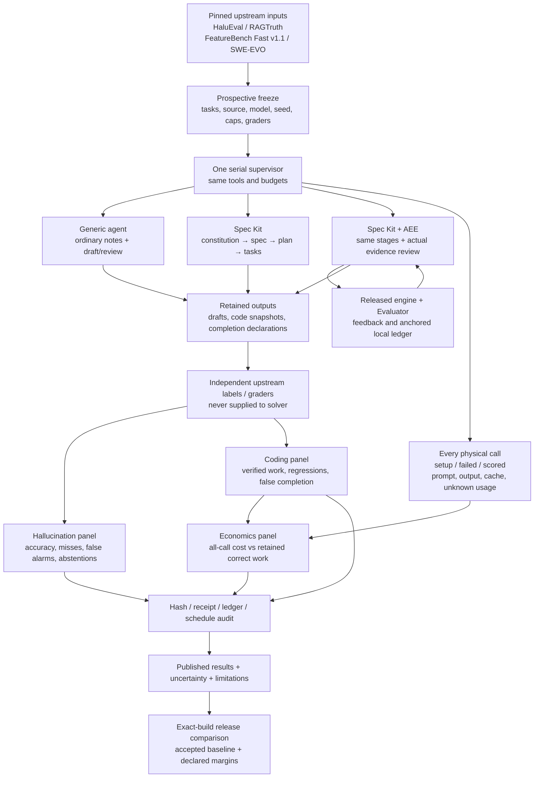

# Established benchmarks and harness I/O

The maintained task definitions, labels and independent graders come from upstream. This repository maintains a thin treatment, provenance and accounting adapter. Older convenience tasks and synthetic factbooks are a read-only historical archive; they are not an expanding benchmark product or a release requirement.

AEE feedback is not an upstream label, an independent semantic oracle, human acceptance or a new correctness score. A local hash-chain anchor establishes local record integrity, not authenticated identity, trusted time or truth. All generated artifacts in the detector study remain unaccepted drafts.

## What the results mean today

| Evidence | Observed result | Supports | Does not support |
| --- | --- | --- | --- |
| [Model-only HaluEval subset](../reports/hallucinations/external-01-20261019/README.md) | 100/120 correct; 17 misses; 3 false alarms | Detection performance on this pinned public subset | Spec Kit/AEE benefit; generated coding hallucination prevalence |
| [Model-only RAGTruth subset](../reports/hallucinations/external-01-20261019/README.md) | 97/120 correct; 11 misses; 12 false alarms | Same-model response grounding on this pinned subset | Full leaderboard score, independent replication or a treatment effect |
| [Matched baseline / Spec Kit / Spec Kit+AEE](../reports/hallucinations/matched-03-recovered-20261020/README.md) | 720 independently graded; HaluEval 70.0/67.5/71.7%; RAGTruth 62.5/61.7/57.5% | Conditional matched classification differences; all paired intervals cross zero | Consistent material benefit, coding savings, independent replication or release equivalence |
| FeatureBench / SWE-EVO | Pinned graders validated; latest upstream attempts stopped before implementation | Suitable established coding suites for the next frozen pilot | Any observed coding savings or long-horizon break-even yet |
| [Historical stopped runs](../START_HERE.md#historical-evidence) | Failed calls and full scheduled denominators retained | Failure diagnosis and real incurred cost | Successful full comparison or generic-failure-as-hallucination labels |

The completed external detector cost 213,457 native tokens, with 0 unknowns. Its 240 one-call classifications are not cost-comparable to the matched two-call workflow plus policy setup. Keep each cohort's costs separately visible.

## Reading future paired findings

* Accuracy includes abstentions in its denominator; also show decisive coverage. False acceptance means an author-labelled hallucination was called grounded; false alarm means an author-labelled grounded response was called hallucinated.
* Compare baseline → Spec Kit, baseline → Spec Kit+AEE and Spec Kit → Spec Kit+AEE on the SAME cases. Bootstrap question/task clusters, not dependent checkpoints as if independent. One generated policy/seed gives conditional uncertainty only.
* Show raw proposed decisions and AEE gate eligibility separately. Blocking every draft can reduce accepted errors while making zero useful deliveries.
* Coding correctness comes from retained upstream grades. Positive/negative/ unknown/ungraded completion declarations stay explicit. Generic failures and AEE findings are not hallucination ground truth.
* Token cost includes setup, failed and scored physical calls. Cache is an input subset, not another charge. Unknown usage is a lower bound with a reason. Local API spend 0 excludes hardware, energy and labor.
* Payback requires matched, retained correct work without increased unsafe completion claims. Show the first observed and sustained crossover only inside measured checkpoints. No success means cost per success is undefined; cheap failures and extrapolated horizons are not savings.

Read [the long-horizon design](long-horizon-economics-plan.md) and [the build/release contract](benchmark-release-gates.md). Public-case exposure, convenience-task history, controller adaptations, outcome-conditioned debugging, local hardware and concurrent CPU work remain disclosed limitations.
