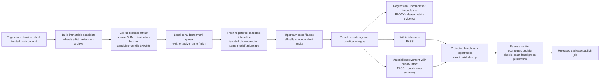

# Benchmark build and release gates

This is prospective release infrastructure, not a passing release certificate. **There is no accepted product-release baseline yet.** `accepted-baselines.json` and `approvals.json` intentionally start empty. The currently running detector study is not interrupted or repurposed into a candidate-release experiment.

## Build → request → measurement → publication

The reusable `benchmark-build-request.yml` builds on hosted Ubuntu, queues the exact distribution bundle and does **not** run inference. Public PR code never runs on a local inference host. A trusted controller must authenticate repository, main commit, workflow path/event and artifact run/digest before execution. Requests are deduplicated by component commit, distribution digest and benchmark protocol; only one study may use the worker. A pending request is not a passing benchmark. No GitHub runner, credential, hosted GPU or signing service is invented here.

The shared verifier resolves one immutable revision of protected benchmark main, requires its exact-head successful CI, finds an exact repository/commit/bundle approval, resolves an accepted baseline, checks bound report hashes and recomputes the comparison. A caller cannot provide `passed=true`, self-pin a new baseline or substitute another artifact. JSON audit flags alone do not authenticate physical measurements: the protected independent audit/publication process remains the trust boundary. Changes to policy/indices require the same protected review and CI.

## What blocks and what is noise

[policy-v1](../benchmarks/releases/policy-v1.json) is registered before candidate release comparisons. It covers detector accuracy/misses, coding correctness and all-call native token cost; it does not combine them into an AEE score.

* Integrity failures, incomplete schedules/grades, unknown token usage, unmatched model/task/seed/cap/grader fingerprints, missing actual ledgers, absent accepted baseline or wrong product SHA/distribution digest block release.
* Accuracy/false-acceptance margins are 2 percentage points; token margin 10%. Five-point quality or 25% token losses block even if intervals are wide.
* A paired 95% interval wholly on the acceptable side of the margin can pass; an interval crossing the unacceptable boundary is inconclusive and blocks. “Not statistically significant” does not demonstrate equivalence.
* A clear improvement beyond the practical margin is highlighted as good news only after every quality gate clears. Cheap failed work earns no savings claim.
* Coding requires actual verified successful work. A two-task pilot has narrow generalizability even when its conditional interval clears; retain this limit. Register independent repetitions/expansion before stronger claims. Never rerun until green or tune margins after looking at a candidate's result.
* Latency is reported separately until a dedicated, repeated same-host timing experiment calibrates its noise. Concurrent CPU work is disclosed; noisy wall time alone does not certify a product regression or improvement.

These are initial explicit guardrails, not measured universal noise estimates. A prospective policy amendment may replace them before a future comparison; never retroactively rewrite a measured approval. Synthetic gate tests verify arithmetic/boundaries only, not empirical gains or authenticated approval.

## Activation and supported release boundary

1. Finish the active matched study and independently validated established coding pilot. Admit a complete, reviewed matched product baseline; the model-only external report, synthetic factbooks and interrupted studies are ineligible.
2. Build candidate dependencies in a NEW environment. Preserve the running baseline's official releases, shared model/service and frozen source. Pin the exact engine and extension artifacts; all other model/task/tool/grader settings must match. Any needed harness change requires both sides under shared logic.
3. Consume queued builds serially only after registered readiness/caps, retain failed/incomplete outcomes, and publish audited evidence through a green PR.
4. Add the baseline/approval references with their hashes to protected indices. The reusable gate then resolves/recomputes approval for the exact build.
5. Product publication jobs must depend on this gate and publish the SAME tested artifact. A workflow without `needs` on the gate is not gated. A post-publication check cannot prevent an already public GitHub release; use a draft/staged promotion path before `gh release create/publish`. Existing PyPI publication must fail closed without approval, even if someone manually published a GitHub release. Repository owners can change workflows/policies; this is not a claim of protection against an administrator overriding the system.

Build requests and verification are usable infrastructure. Automatic local candidate execution and a passing release approval remain pending the accepted baseline and complete candidate-adapter/grader admission. No release is performed by installing these hooks, and no held private development changes are published.

## Reusable integration

Pin both reusable workflow and helper-code checkout to immutable benchmark commits. The request workflow accepts only `engine` in the engine repo or `extension` in the extension repo on trusted main push/manual builds. It returns candidate SHA and bundle digest. A release pipeline calls `benchmark-release-gate.yml` with those values; release/publish jobs use `needs: benchmark-release-gate`. Evidence/index fetches are read-only public GitHub requests; no new cross-repository secret is required. Missing evidence intentionally fails rather than optimistically passing.

[GitHub reusable-workflow documentation](https://docs.github.com/en/actions/how-tos/reuse-automations/reuse-workflows) and [event/security guidance](https://docs.github.com/en/actions/reference/workflows-and-actions/events-that-trigger-workflows) explain the supported triggers and trust boundaries.

## Completed detector comparison and remaining coding work

The [amended matched detector results](../reports/hallucinations/matched-03-recovered-20261020/README.md) cover all 720 scheduled judgments. Baseline / Spec Kit / Spec Kit + AEE accuracy is 70.0% / 67.5% / 71.7% on HaluEval and 62.5% / 61.7% / 57.5% on RAGTruth. All paired intervals cross zero; the same-original-worker sensitivity also does not establish a consistent benefit. Gate eligibility is separate: all 240 AEE proposals remain ineligible. These detector data do not establish coding delivery, spontaneous workflow hallucination prevalence or long-horizon payback.

Original03 remains stopped after a worker crash with 711 retained judgments; the user authorized restoring only the existing profile and completing the missing 9 cells under a fresh frozen episode. The crash cause remains unresolved. All 1,487 physical requests, including technical readiness and the failed/orphan work, retain at least 5,613,402 native tokens and 1 unknown-usage request. This recovery is disclosed, not treated as an uninterrupted campaign, independent replication or a release-equivalence baseline.

## Governance revision, 2026-10-24

The owner settled the release of engine 1.6.0 as a governance decision and adopted a second, additive standard, [policy-v2](../benchmarks/releases/policy-v2.json), recorded in the [governance decision record](../benchmarks/releases/governance-2026-10-24.md). The modeling study of 2026-10-24 proved that no campaign in the current design space can produce the matched rows policy-v1 requires, so that requirement was unproducible rather than merely unmet. An approval registered under policy-v2 binds publication to build identity re-read from public Actions records, exact reproduction of the frozen Spec 006 detector battery, and green suites at the release lineage; the gate resolves it in a separate decision path and the approval states the standard that granted it. Policy-v1 is unchanged and remains the standard for matched-benchmark approvals, and no frozen record or verdict is rewritten. One policy-v1 precondition is deliberately not carried into the governance path: exact-head green benchmark CI, whose only failure at the settlement head is dependency resolution against the unpublished candidate pin itself; the governance decision instead records benchmark CI status in its output and requires post-publication CI verification as a reported settlement step. A governance approval is not a matched-benchmark equivalence result, and no non-inferiority claim may be made from it.

## Release credential requirement (established 2026-10-25)

The engine publish workflow's release step does not use the workflow's built-in token; it authenticates with the credential stored in the repository secret `RELEASE_CREDENTIAL`. That credential must hold the workflow grant: a classic token needs the `workflow` scope alongside `repo`, and a fine-grained token needs the Workflows repository permission alongside Contents. Creating a release also creates its tag on the target commit, and where that commit's tree contains `.github/workflows`, GitHub refuses the creation for a credential without the workflow grant. The refusal is an opaque 403 that names no missing scope; the `gh` command-line tool may add a hint that the workflow scope may be required.

The evidence, from the engine 1.6.0 publication (October 2025): the built-in workflow token was refused ("Resource not accessible by integration"); a fine-grained token with Contents read and write only was refused ("Resource not accessible by personal access token"); a classic token with `repo` only was refused, with the command-line tool's workflow-scope hint; and a classic token with `repo` and `workflow` succeeded (publish run 40211364449; aee 1.6.0 published). The one credential that had succeeded at the identical call before the workflow was amended — the account's OAuth token, in a controlled probe — also holds `repo` and `workflow`.

Standing instructions for the next release:

- Provision the release credential with the workflow grant from the start.
- Prefer the fine-grained form — a single repository, Contents and Workflows permissions — as the least-privilege option. That exact form has not yet been tested; verify it on first use and update this note with the result.
- If a classic token is used, give it a short expiry and revoke it immediately after publication verifies.
- Write credential specifications from the known-working credential's actual grant set, not from the previous specification.

The full record is in the governance amendment files: `benchmarks/releases/governance-amendment-2026-10-25.md`, `benchmarks/releases/governance-amendment-2026-10-25-credential-swap.md`, and `benchmarks/releases/governance-amendment-2026-10-25-scope-correction.md`.
