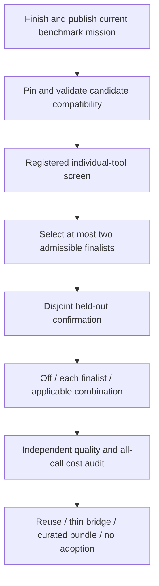

# Optimizer extension evaluation and bundle decision

Status: prospective plan, requested on 2026-10-19. No extension experiment, installation, performance result or bundle implementation is approved by this document alone. Finish the existing matched hallucination and established coding economics studies, independent audits and publication first. This plan never changes an active freeze, accepted baseline, release approval or stopped attempt.

## Questions to answer

1. Which extensions reduce total native tokens for independently correct work, including their setup and operation?
2. Which improve correctness or factual reliability, and what additional cost buys that improvement?
3. Does a benefit survive longer sessions, context restoration, regressions and repeated requirements?
4. Does a tool help the generic agent, Spec Kit and Spec Kit + AEE differently?
5. Which combination adds value beyond its individual components, with the least integration and maintenance burden?

There need not be one universal winner. Publish a quality/cost frontier and separate short-task, long-task and factual-detection conclusions. A cheap failed arm is not a saving.

## Candidates and treatment boundaries

The discovery source is the [official community catalog](https://github.com/github/spec-kit/blob/main/extensions/catalog.community.json), retrieved on 2026-10-19. Versions below are catalog discovery versions, not tested compatibility or immutable execution pins. Before execution, register exact archives, source hashes, licenses, backends, settings and effective activation. Installed-but-inactive is a distinct recorded state.

| Candidate | Discovery version | What to test | Boundary |
| --- | --- | --- | --- |
| [Token Economy](https://github.com/formin/spec-kit-token-economy) | 1.0.0 | Its routing, context audit and reporting integration; RTK, Headroom and token-router separately | A coordinator is not an extra compression algorithm. Pin each underlying tool and include coordinator overhead. |
| [Token Budget](https://github.com/tinesoft/spec-kit-token-budget) | 1.0.1 | A fixed, declared artifact-compaction/phase-scoping/concise-output profile | Preserve originals, accepted requirement inventory, uncertainty, dependencies and contradictions. Aggressive settings are not silently interchangeable with light settings. |
| [Spec Inventory](https://github.com/Yash-Chindam/spec-kit-inventory-alignment) | 0.1.1 | Read-only live inventories and focused task context | A selected task pack must not redefine the global accepted inventory or omit inbound blockers. |
| [ContextForge MCP](https://github.com/capatinore/contextforge-mcp) | 0.1.0 | Code-graph retrieval plus compression, with the actual integration recorded | Codex setup must be demonstrated. Headroom inside this stack is not counted again as an independent saving. |
| [Optimize](https://github.com/sakitA/spec-kit-optimize) | 1.0.0 | Report-only governance audit, then one frozen cleanup profile if admissible | Include the audit/setup cost. Do not change accepted obligations or invent approval of rewritten governance. |
| [Token Analyzer](https://github.com/coderandhiker/spec-kit-token-analyzer) | 0.1.0 | Passive usage/reporting interoperability and its overhead | Character estimates and artifact-quality scores remain separate from native receipts and independent correctness. This is not a new grading layer. |

For Token Economy, the three execution factors are RTK command-output compression, Headroom context compression and token-router evidence selection. AEE's existing optional integrations must be disabled or explicitly matched in the off controls. Avoid two wrappers applying the same optimization accidentally.

Current upstream token-router documents a Codex backend, while the existing AEE adapter expects an Ollama-style interface. Compatibility and the permitted local backend must be resolved before admission. No paid service, extra model, new shared service or implicit second inference stream is introduced. Router inference on the approved worker is serial and fully counted. Headroom memory/navigation features are off unless they are named experimental factors.

## Staged execution

### Phase 0: compatibility and accounting, without scored solver work

* Verify exact version and Codex/Spec Kit compatibility in disposable projects; retain failed installations and missing prerequisites. Do not update the benchmark's baseline environment or global agent configuration.
* Check declared versus effective tool activation, clean enable/disable/uninstall, hook order, duplicate compression, deterministic fallback and recovery from missing tools. Test only these thin integration boundaries; use upstream tests and established benchmark graders for product behavior.
* Demonstrate that independent graders and AEE evidence gates can read original source/log slices. Compression may change solver context; it cannot rewrite author gold, grader inputs, stored raw evidence or an acceptance event.
* Reconcile native worker receipts against any extension telemetry. Record estimates as estimates. Add native cache counters only as subsets of prompt tokens, and never sum overlapping vendor savings into an end-to-end result.
* Classify Token Analyzer as an observer unless it changes prompts or invokes a model; any such behavior becomes an explicit treatment with counted calls. Use Optimize report-only during discovery; a later applied profile is frozen independently of evaluation gold.

A compatibility failure means unsupported or blocked, not zero cost or proof that the optimizer is ineffective. Repairs require affected checks and a new retained admission record; no silent replacement of prior evidence.

### Phase 1: bounded individual screening

Use the same three controls: generic agent, Spec Kit, and Spec Kit + AEE. Screen integrations on Spec Kit + AEE first, since that is the initial bundle target. Predeclare seven candidate configurations: RTK alone, Headroom alone, token-router alone, Token Budget's fixed profile, Spec Inventory, ContextForge's declared stack, and Optimize's frozen profile. Token Analyzer observes outside the solver unless Phase 0 identifies an active effect.

The initial screen is at most ten configurations per task/seed: three controls plus seven candidate configurations. Use one preselected FeatureBench Fast task and one preselected SWE-EVO task on one common registered seed. This is a screen of at most twenty trajectories, not a broad efficacy claim. Each task is independently graded at the same registered checkpoints. Selection is by a metadata/hash rule before reading task statements or gold; retain the complete selection inventory and upstream readiness exposure.

Before the first call, commit an executable registration with the exact task/source/image/grader hashes, applicable cells, model/seed, context/output/time/call/token caps, checkpoint schedule, sampling, treatment files, maximum total study budget, failure policy and analysis. Use the completed baseline's validated common execution contract; if adapters or measurement logic change, run fresh off controls under the same logic. This planning document is not that executable admission, and does not authorize launching work alongside the current study.

Every scheduled configuration runs once under that registration. No best-of output selection, all-success prerequisite, cap extension, gold-aware repair or retry of a scored failure. Model/task failures remain outcomes. The first protocol, infrastructure, identity, context, integrity, response-limit or unknown fault halts the affected campaign immediately. Preserve its costs and schedule before diagnosing a concrete harness defect and prospectively admitting a new attempt.

Select at most two finalists using a published quality-first rule: complete trustworthy accounting and invariant preservation first, independently graded quality next, then native cost at comparable quality and operational burden. A finalist may be promising or inconclusive; screening cannot establish equivalence or justify a release approval. Do not select an apparently cheap arm that completed less correct work. If none are admissible, publish that result rather than forcing a bundle.

### Phase 2: confirmation and interaction tests

Freeze a new selection of disjoint upstream tasks, with at least one new FeatureBench repository and one SWE-EVO project where the available population permits it. Use at least two registered seeds. If the population or budget is too small, report the resulting limited scope rather than claim replication. Freeze candidate profiles before viewing confirmation gold or outcomes; no tuning from confirmation results.

For each of the three workflows, compare off, finalist X, finalist Y and X + Y where meaningful: at most twelve applicable cells per task/seed. A Spec Kit-only extension is structurally inapplicable to an agent without Spec Kit; mark that cell not applicable rather than installing Spec Kit into the generic control. Standalone tool equivalents can be separate, explicitly registered cells. A combination needs a declared order and cannot quietly add memory, retrieval, inference or another optimizer.

Use paired task/seed comparisons and cluster uncertainty by independent task or question/source, not dependent checkpoints. With two candidate selections, make confirmation the primary analysis; screening remains exploratory. Report all registered contrasts and failures, not just a winning comparison. Any additional samples or candidates require a new prospective registration, not repeat-until-positive inference.

## Separate outcome panels

| Panel | Primary evidence | Required reporting |
| --- | --- | --- |
| Short-task coding | FeatureBench Fast author tests and retained source | Correct feature/regression outcomes, declarations joined to grades, setup-inclusive tokens and undefined cost per success when there are no successes |
| Long-horizon work | SWE-EVO official final grades plus named adapted checkpoints | Retained correct requirements, rework/regressions, context restoration cost and observed first/sustained quality-gated crossover |
| Factual reliability | A separate matched HaluEval/RAGTruth study with unchanged author labels | Accuracy, false acceptance, false alarms, abstentions, unknown/ungraded cases and native token overhead by dataset |
| Operations and maintenance | Actual integration/install/restore logs and issue records | Supported platforms/backends, setup time, extra processes/dependencies, activation failures, intervention count and ownership burden |

Keep factual tests separate from coding economics. Use disjoint held-out author-labelled cases for confirmation; an unmodified selected panel is reused across treatments. RTK need not have a meaningful direct effect on a detector with no shell outputs; mark non-applicability rather than simulate a fake workload. AEE findings, generic test failures and compression ratios are not hallucination labels.

Count all setup, governance audits, policy generation, compression/routing inference, indexing, failures, scored work and context restoration. Publish native prompt/output/cache/unknown counters; record CPU time and tool storage separately. Local API spend is zero and excludes hardware, energy and labor. Per-task direct comparisons and study-wide failed-preparation costs stay separately visible. Do not add an estimated uncompressed counterfactual to real native usage.

Payback is observed only at registered measured checkpoints where correctness is retained and unsafe completion does not increase. Require at least two observed checkpoints for sustained crossover, retaining any later reversal. No success leaves cost per success undefined. No crossover means no demonstrated payback, not a projected future saving. Official SWE-EVO scores remain distinct from any constructed persistent-release sequence or intermediate checkpoint adaptation.

## Decision thresholds and bundling

Use the existing [prospective release comparison policy](../benchmarks/releases/policy-v1.json) as the initial confirmation guardrail, with exact applicable metrics registered before execution. Its quality margin is 2 percentage points and native-cost margin is 10%; gross losses are 5 points and 25%. These are policy thresholds, not measured universal noise. Confidence intervals crossing a margin are inconclusive; lack of significance is not equivalence. Small coding pilots cannot certify a tight margin or broad superiority.

Report material quality gains even when they cost more, but label the tradeoff. A gross cost increase cannot be sold as a cost-saving default; a gross quality loss blocks default adoption. A cost-benefit winner must have independently supported acceptable quality and lower all-call cost. Otherwise, prefer the simpler incumbent or an explicitly optional quality-focused profile. Publish favorable and unfavorable findings with the same prominence.

Choose architecture only after the evidence:

* Reuse an existing extension when it supplies the demonstrated benefit with compatible activation and accounting.
* Prefer a [native Spec Kit bundle](https://github.com/github/spec-kit/blob/main/docs/reference/bundles.md) for composing existing extensions, presets and workflows. A bundle manifest alone does not prove that external executables are installed, configured or active.
* Add a thin companion only for demonstrated missing integration: explicit activation, raw-evidence handoff, accounting joins or reversible profiles. Avoid vendoring optimizer engines or duplicating upstream functionality.
* Keep AEE's evidence/acceptance semantics independent from context compression. Preserve missing/unknown states, human-review boundaries and original evidence. No new score layer or automatic acceptance promotion.
* Offer a small tested default and separately named optional profiles; do not ship every discovered extension as a default stack. Resolve hook conflicts, duplicate optimization and maintenance ownership before release.

The deliverable is an audited comparison report, full scheduled inventory, immutable receipts/grades, uncertainty and limitations, followed by a reasoned reuse/bundle/no-adoption recommendation. Publish through the normal exact-head green PR workflow. No optimizer installation, candidate release approval or completed-study claim follows from this plan alone.
