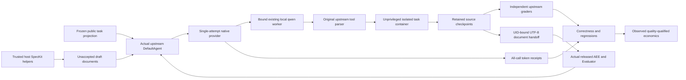

# Established coding adapter: readiness and remaining work

The matched detector comparison is [complete and audited](../reports/hallucinations/matched-03-recovered-20261020/README.md). Coding inference has not started. The [draft registration](../benchmarks/upstream-coding/registration-draft-v1.json) is preparation, not admission or a promise that a model will solve these tasks.

The adapter uses the actual pinned mini-swe-agent 2.4.6 DefaultAgent, native bash tool parser/observation formatter and DockerEnvironment. A thin single-attempt provider records the original native request, response, usage and finalized receipt hash. The paid/retrying upstream backend is not invoked. Registered context/call/token/output limits fail instead of truncating history; remaining task wall time bounds provider/helper timeouts; a provider failure latches the episode closed. Original request failure remains visible if secondary receipt persistence also fails.

All imports require disabled dotenv, a dedicated empty global configuration directory and a credential-file audit guard in a sanitized child environment. Actual Docker commands use the fixed unprivileged setpriv interpreter; model text cannot replace the user boundary. Owned container cleanup uses direct Windows-safe argv and label verification. These are local bounded controls, not protected host identity or a proof that every possible gold leak is absent.

## Actual control evidence

* The native-tool control invokes the original agent/parser and actual Docker commands with canned replies: successful submission after two actions, and an intentional failed command that halts before a second action. UID 999, zero effective capabilities, NoNewPrivs 1 and owned cleanup are checked. It makes zero worker/model calls and establishes no model performance or task correctness.
* Read-only restored-worker checks bind the existing process/listener, unchanged weights and native build, then exercise actual tool-schema and tool-observation template/tokenization. They make zero generation requests and do not establish tool delivery, model reliability, latency or campaign admission.
* Retain the initial control failure: upstream Docker metadata queried Windows host uname. The wrapper now uses separately observed Linux container facts. Retain the initial read-only helper-import failure; explicitly loading the local transport error helper fixes it. Neither failure was a scored model outcome or a server failure.
* A separate real host-managed workflow control exercises the original SpecKit helpers and released AEE/Evaluator at specify, plan, tasks and implementation. Four actual assessments/ledger entries return iterate; baseline and SpecKit controls receive no AEE assessments. Proposal bytes are synthetic, not model results or accepted implementations. The initial Windows UTF-8 prompt-read failure is retained and corrected with explicit UTF-8 reads.

## Remaining admission

The unprivileged document handoff and source snapshot controls pass on real containers with controlled fixture bytes. All four retained actual tasks also pass source preparation and initial/unchanged capture. Pandas has a pre-existing CRLF-versus-Git normalization difference; it is preserved separately, while solver changes are measured against the initial literal file tree. A controlled CRLF patch also applies successfully to its declared source baseline. Snapshot capture includes modifications, deletion, nonignored untracked files, binary bytes, execute modes and symlinks, and the patch applies to its bound baseline. Repository clean filters, text conversion and external diff commands do not execute, and the original Git index is not staged. Scoped file reads exclude ignored untracked files and do not prove transient or full-environment immutability. The actual full cold/warm join now has zero-model control evidence. Final clean-source registration, hosted checks and native delivery/context/timing admission remain required before solver work. The Python 3.8 task runtimes must not be silently replaced merely to run framework helpers; host-managed framework adaptation must be disclosed and must never execute agent-modified scripts on the host.

Preserve all five preselected candidate records and all failed gold/resource preparations. The current draft retains two FeatureBench tasks and the two-release Dask chain. Both Pydantic candidates remain unadmitted before solver work: the first has unresolved base resource readiness; the second has all three author-labelled fail-to-pass targets already passing on the unchanged base under the prepared environment. No new task replaces them, and no label, test or future dependency is substituted to manufacture discrimination. The full base negative control stopped earlier on a datetime failure and did not by itself establish target-test discrimination. The corrected SWE-EVO grade path merges the candidate with the original held-out test patch, as the pinned upstream wrapper does. The first negative Dask probe omitted that merge and failed collection; it is retained. Corrected probes show an actual author target failure on each unchanged Dask base, while previous complete gold controls pass. A broader first-release probe also retains collection failures for an API absent from the base; missing test IDs remain unknown rather than fabricated failures. A real two-resource Dask transfer control carries a literal source tree with a controlled marker through an 8,576,641-byte Git tree/blob pack. All 485 file path/mode/content hashes match after UID-bound restoration in the second resource. The original second-resource source and Git history are removed before the retained tree is restored; the receiver has one fresh commit and no future release object. No pack is extracted or executed on the host, and no root process executes the carried source. This controlled transfer uses zero model calls and establishes no solution correctness. Dask release two must retain actual solver work rather than an author solution. Its adapted starting source and checkpoint grades stay separate from official standalone claims.

Freeze the final task/input/grade/resource/source inventory, schedule, limits and treatment workflow; pass hosted checks and fresh native delivery/context/latency readiness before one serial coding study. Keep all original failed preparations and all setup/failed/scored calls. No coding savings, regression rate, accepted delivery or payback is asserted before independent retained-source grading. Generic test failures are not hallucination labels.

## Cold and warm project controls

Actual three-arm controls now exercise both releases with the original agent/parser, isolated bash tools, source packs and trusted host helpers. The baseline retains its first brief and writes a second brief. Spec Kit and Spec Kit+AEE retain the same project and unaccepted constitution, preserve feature 001 and create feature 002. AEE records four actual assessments per release in one eight-entry anchored ledger. All replies are canned controls, with zero worker/model requests; their scripted call counts and dummy usage are not economic findings. Empty submitted patches are preserved separately from the complete source tree and never become accepted delivery. An intentional failed command in the earlier full control stops before another action and retains source.

The source-to-grader adapter retains the complete workspace while deriving a separate non-test submission patch. This prevents an earlier release's carried tests from replacing the independent author tests. A raw whole-tree negative exposed that overlap before inference and remains retained. The strict SWE wrapper uses the unchanged upstream grading functions with one atomic patch application and literal candidate content; reject/fuzz retries are disabled. Positive author gold passes all 712 required Dask release-two IDs; the actual projected earlier source is unresolved, with missing tests retained as unknown after the first failure. This is readiness evidence, not a coding model outcome.

## Frozen execution and independent grading

The controller prepares exact upstream task bytes, controller-only full rows and a resource/readiness evidence archive. A clean, exact-head hosted-green source is required before the source/runtime/input/schedule freeze. Nine randomized scheduling units contain twelve task endpoints: two cold starts and one ordered two-release Dask sequence for each arm. A setup-only admission then makes four physical native calls with the original bash tool: short delivery/history checks and two 24,000–24,576-token technical contexts. Their complete usage and any failed requests count separately from scored work. No selected task, author solution or held-out label enters those prompts. Existing output paths cannot be resumed or overwritten.

The one serial scorer retains original native receipts, planning documents, feedback, source snapshots and literal Git tree/blob packs. The 14,400-second per-task solver window begins after resource preparation; resource preparation, cleanup and later grading are measured separately. No hidden grading occurs before generation is terminal. An explicit model instruction preserves author test directories and conftest files; a final integrity check refuses changes in that declared scope. This does not prove the absence of all transient modification or cheating.

The offline grader measures the original submitted patch separately from the non-test retained workspace projection. Empty proposals are never replaced by a good retained tree to claim delivery. An identical patch for the same task can reference an existing independently retained grade; missing checkpoints stay ungraded. Original author tests and labels remain unchanged. Failed tests are correctness outcomes; missing IDs remain unknown. Raw logs, source hashes and native-cost joins still require an independent audit before publication. These controls establish neither task success nor an observed economic payback.

## Retained first coding stop and corrected initialization

The first coding episode halted on its first scored tool call: the supplied Spec Kit constitution command required reading `.specify` scaffolding that had only been initialized on the trusted host. The compound file read exited 1. All four setup calls and the failed scored call remain retained: 54,206 native tokens, no unknown usage. Eleven later endpoints were unattempted. Its initial/stopped source received offline grading; this is not a paired economic result or a measured AEE benefit.

A fresh prospective amendment initializes public templates, placeholder documents and arm-specific hook metadata in the actor before any model call. The controller constitution, controller scripts, stores and gold remain unavailable. Helpers and hooks still execute only through the trusted host adapter. Initialization is captured separately from the pristine upstream source and is not attributed to solver code work. Baseline receives no framework or AEE configuration. Warm project drafts remain carried data, and unchanged placeholders cannot become completed documents. The first-failure stop rule, caps, original tasks and independent grades are unchanged. A real zero-model check must reproduce the exact failed filesystem read successfully before another frozen coding episode.

The next episode also stopped at its first call: the earlier document reads passed, but listing the still-missing public `.specify/scripts` directory exited 2. Episode 02 retains five physical calls and 54,278 native tokens, no unknown usage, and eleven unattempted endpoints. The original public helper installation had been projected incompletely; testing only the earlier read did not establish full project-layout readiness.

The corrected actor projection includes all pinned public Specify Python helpers and, only in the AEE arm, explicitly allowed released extension client assets and default metadata/schema files. Controller scripts, the controller constitution, mutable runtime environments, assessments, ledgers, stores, gold and credentials stay excluded. Public client code is inspectable in the actor; the treatment contract continues to run framework helpers and AEE/Evaluator only through the trusted host adapter. No actor-modified code executes on the host. Cold and warm controls must compare the complete allowed file inventory and execute the extended failed read before fresh admission. Neither stopped episode establishes delivery or token payback.

A third episode passed all four actual tool actions but stopped on the four-call planning limit before writing/submitting. That phase limit had not been communicated to the model. Its eight physical calls retain 78,974 native tokens with no unknown usage; eleven later endpoints were unattempted. A prospective amendment exposes the unchanged per-phase, whole-task call and native-token budgets before every query for every arm. It also states that writing the file and the final submission echo may share a bash action, as the original tool interface already supports. No call, time, output or token limit is increased. This is disclosed harness development after failed preparations, not evidence of economic benefit or a selection of successful solver outcomes.

## Audited stopped preparations, 2026-10-20

[The four stopped-episode audit](../reports/local/upstream-stopped-01-04-20261020/README.md) reconciles all 23 physical generation requests and 241,913 known native tokens, with 0 usage unknowns. Each attempt reached only the first constitution phase, with 11 later endpoints unattempted, no final submitted proposal and no scored AEE assessment. Retained original source grades observed 1 passing required test and 3,519 unknown IDs; official resolution is false. Unknown IDs are not failures. These are failed preparations, not a paired treatment comparison or observed payback. No new inference is active. Continuing other scheduled comparisons after a known model failure requires a direct change to the current whole-study stop instruction; publication does not activate that proposed change.
