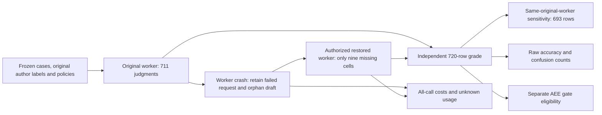

# Matched hallucination classification: completed amended schedule

**No consistent material AEE advantage is established.** Spec Kit + AEE is higher on HaluEval and lower on RAGTruth; all paired accuracy-difference intervals include zero. This is a response-detection experiment, separate from coding correctness, spontaneous hallucination prevalence and long-horizon payback.

| Author-labelled response classification | Baseline | Spec Kit | Spec Kit + AEE |
| --- | ---: | ---: | ---: |
| HaluEval accuracy (120 each; abstentions count as incorrect) | 70.0% | 67.5% | 71.7% |
| RAGTruth accuracy (120 each; abstentions count as incorrect) | 62.5% | 61.7% | 57.5% |

Original03 stopped after 711 judgments when its worker crashed. The user explicitly authorized restoring the existing profile and completing only the nine missing cells in a separately frozen episode04. All 720 scheduled cells are now graded, with zero invalid or ungraded final judgments. Original03 remains stopped and immutable; this is an amended two-epoch comparison, not an uninterrupted run or independent replication.

## Factual reliability and uncertainty

| Dataset | Arm | Correct / 120 | Missed hallucinations | False alarms | Abstentions | Precision | Recall over all positives |
| --- | --- | ---: | ---: | ---: | ---: | ---: | ---: |
| HaluEval | Baseline | 84 | 16 | 2 | 18 | 94.4% | 56.7% |
| HaluEval | Spec Kit | 81 | 15 | 6 | 18 | 86.4% | 63.3% |
| HaluEval | Spec Kit + AEE | 86 | 10 | 4 | 20 | 90.9% | 66.7% |
| RAGTruth | Baseline | 75 | 5 | 18 | 22 | 73.9% | 85.0% |
| RAGTruth | Spec Kit | 74 | 4 | 25 | 17 | 67.9% | 88.3% |
| RAGTruth | Spec Kit + AEE | 69 | 7 | 12 | 32 | 79.3% | 76.7% |

A missed hallucination is an author-labelled hallucinated response called grounded; a false alarm is an author-labelled grounded response called hallucinated. Abstention is separate from either error and remains in the accuracy/recall denominator. Each dataset has 60 positive and 60 negative responses per arm; these balanced subsets do not estimate deployment prevalence. HaluEval uses 60 paired question clusters and RAGTruth 120 source clusters.

| Dataset | Right minus left | Accuracy difference | Conditional cluster-bootstrap 95% interval |
| --- | --- | ---: | ---: |
| HaluEval | Spec Kit minus Baseline | -2.50 pp | [-11.67, +6.67] pp |
| HaluEval | Spec Kit + AEE minus Spec Kit | +4.17 pp | [-6.67, +15.00] pp |
| HaluEval | Spec Kit + AEE minus Baseline | +1.67 pp | [-7.50, +10.00] pp |
| RAGTruth | Spec Kit minus Baseline | -0.83 pp | [-7.50, +5.83] pp |
| RAGTruth | Spec Kit + AEE minus Spec Kit | -4.17 pp | [-13.33, +5.00] pp |
| RAGTruth | Spec Kit + AEE minus Baseline | -5.00 pp | [-15.00, +3.33] pp |

Intervals use 2,000 seeded question/source-cluster resamples and are conditional on one generated policy per dataset/arm and one seed. Crossing zero does not establish equivalence or prove a difference is harmless noise. The same-original-worker sensitivity excludes all nine affected case indices symmetrically across every arm: 231 cases / 693 rows, HaluEval 114 responses per arm and RAGTruth 117. Its intervals also cross zero; exact counts and intervals are in [the independent grade](independent-grade.json).

## AEE gate is separate from classification

All 480 scored AEE assessments returned iterate; 13 setup assessments were also independently joined to their policy/calibration artifacts and local ledgers. The 240 AEE final proposals therefore remain gate-ineligible, while their raw classifier verdicts are still graded above. Zero eligible AEE outputs must not be presented as perfect hallucination prevention or accepted delivery. Local anchored integrity is not protected identity, semantic truth or human acceptance. No judgment was promoted to human-accepted.

## All-call token economics

| Arm (policy/calibration, scored, failed and recovery calls) | Requests | Native prompt | Native output | Known native total | Usage unknown |
| --- | ---: | ---: | ---: | ---: | ---: |
| Baseline | 487 | 801,749 | 60,971 | 862,720 | 0 |
| Spec Kit | 498 | 2,020,749 | 68,238 | 2,088,987 | 1 |
| Spec Kit + AEE | 496 | 2,585,776 | 74,439 | 2,660,215 | 0 |

The two study episodes retain 1,481 requests and at least 5,611,922 known native tokens, including the abandoned successful draft and failed review. Six separate native-readiness calls add 1,480 tokens: **1,487 total physical requests, at least 5,613,402 native tokens, one request with unknown usage**. No failed request is assigned zero actual usage. Known cached tokens are zero and retained separately; cache would be an input subset, not a second charge.

The AEE arm used 3.08 times the baseline known token count and 1.27 times the Spec Kit lower-bound count in this particular classifier workflow. The Spec Kit failed-request unknown makes its actual total larger than the displayed lower bound. The observed results do not establish token savings or a quality-qualified payback point. These are not coding economics; FeatureBench/SWE-EVO solver results remain pending. Local API spend 0 excludes hardware, energy and labor.

Earlier preparations/stopped runs have additional costs, preserved in their separate reports and bounded historical inventories. This table is all-call accounting for these two matched episodes and their native readiness, not an all-history total or pooled efficiency claim. [External01](../external-01-20261019/README.md) used a different one-call/output-cap protocol and is not a treatment-control comparison for this result.

## Integrity, recovery and limitations

* Original source c72d54f4b876454ab2c11216d74959b123a72a09 and all 339 declared source/archive inputs stayed unchanged. The original 32,591-file stop inventory was independently reverified.
* Recovery source 286f3d8348c9c07d7f9a8c0227e790528698ad9b passed exact-head Ubuntu checks and merged in [PR49](https://github.com/electrohire/spec-kit-aee-benchmark/pull/49) with protections unchanged. Only five pinned AST port/endpoint literals changed in the transport; original Provider, judge, policies, labels, budgets and sampling were reused.
* Windows recorded Application Error 1000, ucrtbase.dll and c0000409 for the original worker. The underlying crash cause remains unresolved; no CUDA, memory or security cause is inferred. The restored profile/weights/build were verified and no other service/model configuration changed.
* Nine whole cells were completed in original schedule order: five baseline, three Spec Kit and one AEE. Neither the 711 completed cells nor the earlier completed external/synthetic tests were rerun. Three separately registered readiness calls preceded the 18 recovery calls; no automatic retry was used.
* Public-case exposure, single policies/seed, outcome-conditioned harness debugging, the recovery amendment, document-to-classifier adaptation and concurrent CPU validation limit generalization. Timing is descriptive. No full HaluEval/RAGTruth leaderboard or independent replication is claimed.
* This does not validate a release baseline or candidate equivalence. Accepted delivery, coding completion proxies, regressions and observed long-horizon payback require the separately registered coding study.

[720 independent rows, raw/gate metrics and sensitivity](independent-grade.json) · [All physical request receipts, usage and hashes](physical-calls.json) · [Frozen evidence file inventories](retained-inventories.json) · [Original stop](original-stop.json) · [Recovery registration](../../../benchmarks/hallucinations/completion-recovery-04.json).
